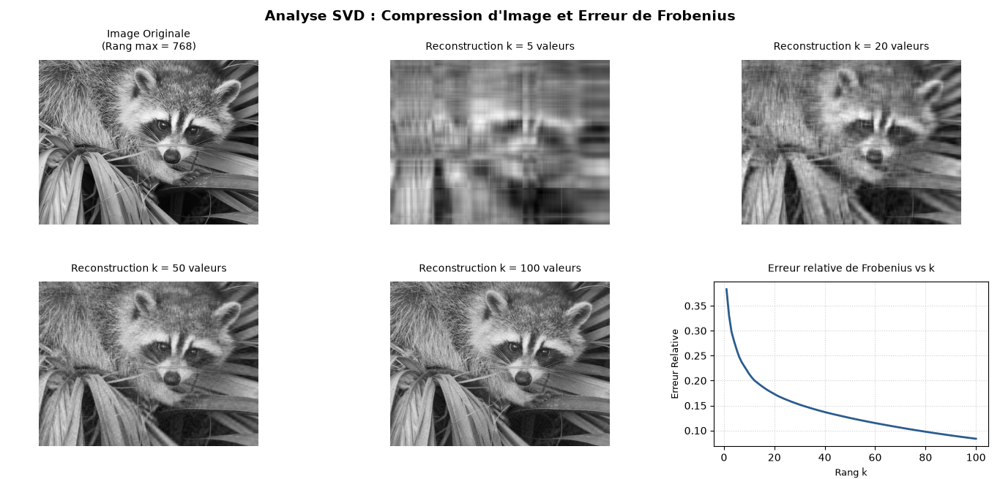

# Décomposition en Valeurs Singulières (SVD) : Réduction de Dimension et Compression d'Image

Ce projet d'**Algèbre Linéaire Numérique** illustre l'utilisation de la **Décomposition en Valeurs Singulières (SVD)** pour l'approximation de matrices de rang faible (*Low-Rank Matrix Approximation*) et son application directe à la compression d'images et à la réduction de dimension.

## 📌 Contenu du Projet

- **`SVD_Reduction_Dimension.py`** : Script Python calculant la factorisation SVD ($A = U \Sigma V^T$), la reconstruction de rang $k$, et la norme de Frobenius du bruit/erreur.
- **`SVD_Reduction_Dimension.png`** : Visualisation comparative des reconstructions ($k \in \{5, 20, 50, 100\}$) et courbe de l'erreur relative.
- **`SVD_Reduction_Dimension.pdf`** : Rapport académique complet rédigé en $\LaTeX$ contenant les preuves théoriques du théorème d'Eckart-Young-Mirsky.

## 🛠️ Technologies Utilisées

- **Python** (`NumPy`, `Matplotlib`, `SciPy`)
- **$\LaTeX$** (Formalisation théorique et preuves algébriques)

## 📐 Fondements Mathématiques

Conformément au **Théorème d'Eckart-Young-Mirsky**, la matrice $A_k$ obtenue en ne conservant que les $k$ premières valeurs singulières constitue la meilleure approximation de rang $k$ de la matrice initiale $A$ au sens de la norme de Frobenius :

$$\min_{\text{rank}(B) \le k} \Vert{}A - B\Vert{}_F = \Vert{}A - A_k\Vert{}_F = \sqrt{\sum_{i=k+1}^{r} \sigma_i^2}$$

## 📄 Rapport Académique

Pour consulter les démonstrations d'algèbre linéaire et l'analyse théorique complète :  
👉 **[Consulter le rapport complet (PDF)](./SVD_Reduction_Dimension.pdf)**
## 📊 Aperçu des Résultats

